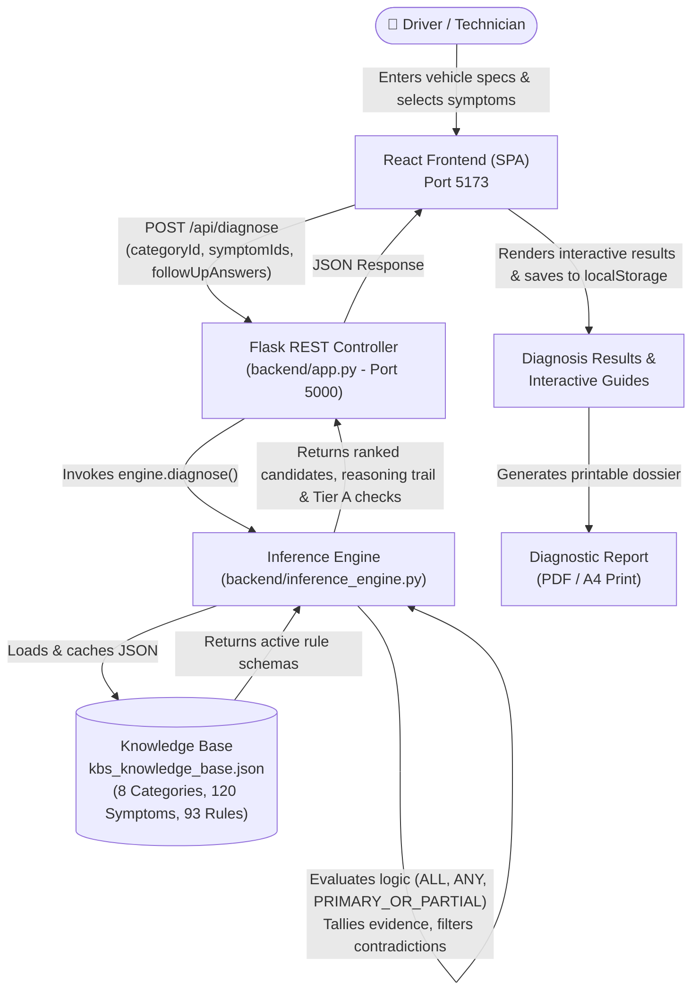
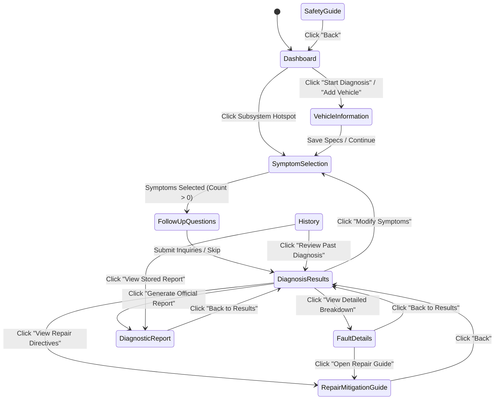
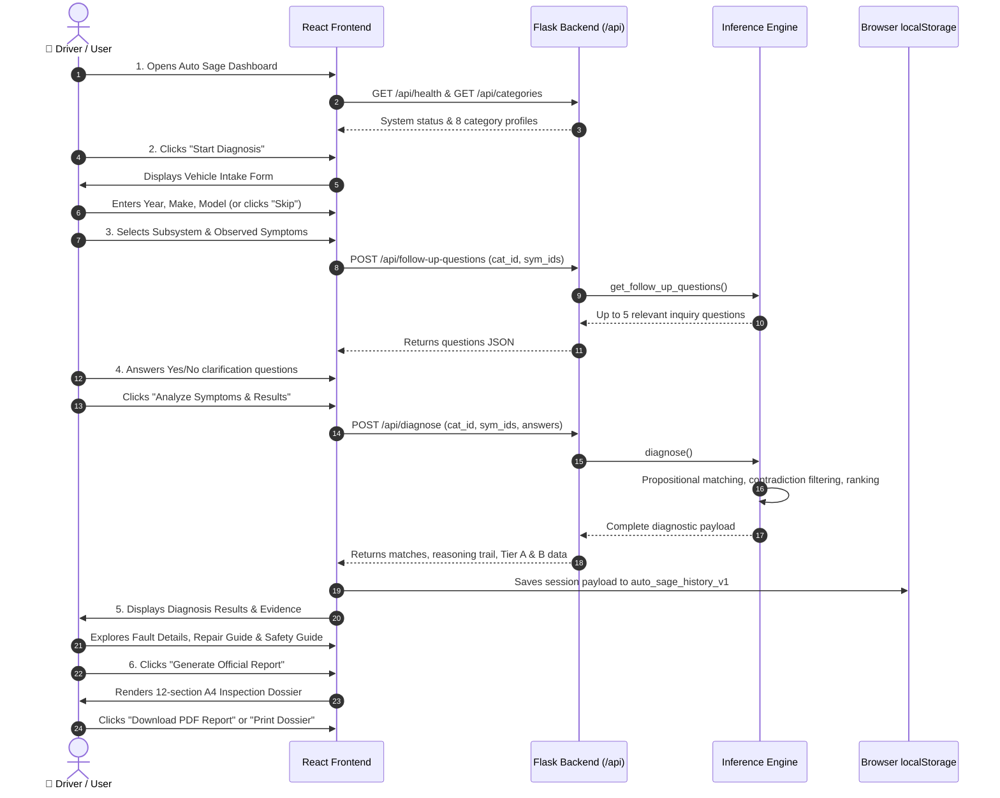
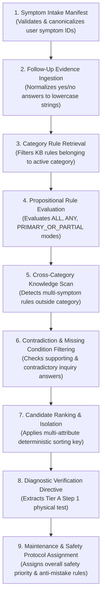
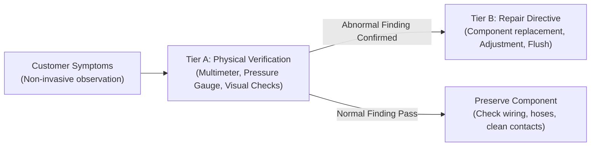
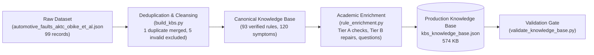
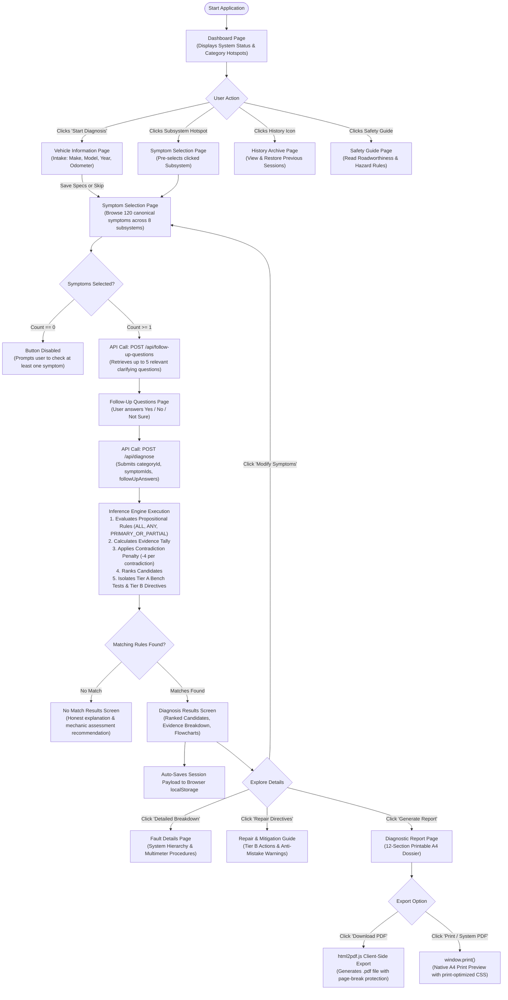

# Auto Sage — Complete Project Working & Technical Walkthrough Guide

**System Name:** Auto Sage — Intelligent Car Fault Diagnosis System  
**Course Context:** Knowledge-Based Systems (CT-359)  
**System Type:** Rule-Based Expert System / Deterministic Automotive Diagnostic KBS  
**Project Workspace:** `D:\CARFAULTDIA`  
**Dataset Provenance:** *Automotive Faults Dataset for Diagnostic and Maintenance Systems* (Obike & Obot, 2024), Zenodo DOI: [10.5281/zenodo.15626055](https://doi.org/10.5281/zenodo.15626055), CC BY 4.0  

---

## Table of Contents
1. [Project Introduction](#1-project-introduction)
2. [Problem Statement](#2-problem-statement)
3. [Project Objectives](#3-project-objectives)
4. [Technologies Used](#4-technologies-used)
5. [Complete Architecture](#5-complete-architecture)
6. [Folder and File Structure](#6-folder-and-file-structure)
7. [Every Frontend Page Explained](#7-every-frontend-page-explained)
8. [Complete User Workflow](#8-complete-user-workflow)
9. [Knowledge Base Explained](#9-knowledge-base-explained)
10. [Real Diagnostic Rules Explained](#10-real-diagnostic-rules-explained)
11. [Inference Engine Explained](#11-inference-engine-explained)
12. [Follow-up Question Mechanism](#12-follow-up-question-mechanism)
13. [Real Diagnosis Scenario 1 — Full Match](#13-real-diagnosis-scenario-1--full-match)
14. [Real Diagnosis Scenario 2 — Partial Match & Follow-up Refutation](#14-real-diagnosis-scenario-2--partial-match--follow-up-refutation)
15. [Real Diagnosis Scenario 3 — Contradictory Evidence & Honest No Match](#15-real-diagnosis-scenario-3--contradictory-evidence--honest-no-match)
16. [Backend REST API Explained](#16-backend-rest-api-explained)
17. [Repair and Mitigation System](#17-repair-and-mitigation-system)
18. [Safety System & Operational Advisories](#18-safety-system--operational-advisories)
19. [Diagnostic Report Generation](#19-diagnostic-report-generation)
20. [Diagnosis History & Local Persistence](#20-diagnosis-history--local-persistence)
21. [Dataset and Knowledge Acquisition Pipeline](#21-dataset-and-knowledge-acquisition-pipeline)
22. [Automated Testing & Verification](#22-automated-testing--verification)
23. [System Limitations & Honest Boundaries](#23-system-limitations--honest-boundaries)
24. [Complete System Flowchart](#24-complete-system-flowchart)
25. [Frequently Asked Viva & Teacher Questions](#25-frequently-asked-viva--teacher-questions)

---

## 1. Project Introduction

**Auto Sage** is a deterministic, symptom-based Knowledge-Based System (KBS) designed to assist vehicle owners, apprentice mechanics, and service advisors in identifying potential vehicle mechanical and electrical faults. 

Unlike black-box Machine Learning (ML) classifiers or probabilistic neural networks that output unexplainable percentages (e.g., *"83% confidence"*), Auto Sage operates using **classical Expert System principles**:
- Diagnostic knowledge is formally separated into a structured **Knowledge Base** (`backend/data/kbs_knowledge_base.json`).
- Reasoning is performed by an independent **Inference Engine** (`backend/inference_engine.py`) executing deterministic propositional logic ($P \implies Q$).
- Every finding is transparently explained through observable customer symptoms, physical bench test criteria (Tier A checks), and workshop maintenance directives (Tier B protocols).

Auto Sage is grounded in peer-reviewed automotive empirical data collected by Peter Obike and Okure Obot at the Akwa Ibom Transport Corporation (AKTC) mechanical workshops, archived on CERN Zenodo.

---

## 2. Problem Statement

Modern automobiles are complex machines combining internal combustion, hybrid powertrains, hydraulic circuits, electrical harnesses, and electronic sensors. When a driver observes an anomaly (such as a spongy brake pedal, engine pinging, or coolant puddles), they face three critical problems:
1. **Information Asymmetry & Expensive Guesswork:** Drivers lack technical expertise and risk paying for unneeded repairs or replacing good parts due to hasty guesses.
2. **Safety Hazards:** Continuing to drive with compromised critical systems (e.g., hydraulic braking failure or severe overheating) risks catastrophic collisions or total engine seizure.
3. **Premature Component Replacement:** Unscrupulous or inexperienced technicians frequently replace expensive assemblies (e.g., replacing a \$500 brake booster when the real issue was a \$15 vacuum hose crack).

Auto Sage solves this by providing **systematic triage**: translating physical driver-observed symptoms into ranked fault hypotheses, distinguishing verified findings from unverified possibilities, specifying exact bench testing steps, and issuing anti-mistake directives before any parts are replaced.

---

## 3. Project Objectives

1. **Deterministic Rule-Based Triage:** Implement propositional logic matching over 93 verified diagnostic rules spanning 8 primary automotive subsystems.
2. **Follow-Up Inquiry Corroboration:** Narrow broad symptoms through targeted secondary questions that corroborate candidate faults or refute contradictory findings.
3. **Two-Tier Diagnostic Separation:** Strictly separate non-invasive symptom identification from **Tier A Physical Bench Checks** (multimeters, pressure gauges) and **Tier B Repair Directives**.
4. **Professional Workshop Reporting:** Produce audit-ready vehicle inspection reports complete with vehicle intake specs, bench check checklists, technician notes, and legal provenance.
5. **Session Isolation & Privacy:** Execute completely on local infrastructure without cloud tracking, third-party user logins, or persistent remote databases.

---

## 4. Technologies Used

| Layer | Technology | Version / Tooling | Purpose in Auto Sage |
| :--- | :--- | :--- | :--- |
| **Frontend UI** | **React** | v18.3.1 (Vite 5.4) | Single Page Application (SPA), state management, dynamic symptom search, and reactive step-by-step triage workflow. |
| **Styling & Icons** | **Tailwind CSS & Material Symbols** | Tailwind 3.4, Google Fonts | Responsive automotive design system following the original Google Stitch automotive studio theme. |
| **Document Export**| **html2pdf.js & Native Print CSS** | html2pdf.js 0.10.3, CSS `@media print` | High-fidelity A4 multi-page PDF generation with page-break protection and print optimization. |
| **Backend REST API**| **Python Flask** | Python 3.12/3.14, Flask 3.1.2 | Lightweight HTTP microservice hosting CORS-restricted endpoints for categories, symptoms, questions, and inference. |
| **Inference Engine**| **Pure Python** | Python standard library (`json`, `re`, `pathlib`) | Deterministic propositional rule evaluation, candidate ranking, follow-up tallying, and reasoning trail generation. |
| **Knowledge Base** | **JSON** | `kbs_knowledge_base.json` (574 KB) | Hierarchical knowledge representation storing 8 categories, 120 canonical symptoms, and 93 enriched diagnostic rules. |
| **Client Storage** | **Browser `localStorage`** | Web Storage API (`auto_sage_history_v1`) | Secure, local persistence of past diagnostic sessions, inspection payloads, and generated report IDs. |
| **Testing** | **Node.js test runner & Python `unittest`** | `node --test`, `unittest` | 13 frontend unit tests, 29 backend engine tests, and full end-to-end integration verifications. |

---

## 5. Complete Architecture

The application strictly separates knowledge representation, inference reasoning, REST presentation, and client UI.



### Architectural Highlights:
1. **Stateless Backend:** The Flask backend does not maintain user sessions or server-side databases. Every diagnosis request is self-contained.
2. **In-Memory Rule Cache:** The Knowledge Base is validated on load and cached in memory using an LRU cache keyed by file modification timestamp (`mtime`), ensuring sub-millisecond reasoning response times.
3. **Session Isolation:** Sequential diagnoses on the frontend do not bleed state. Resetting or starting a new diagnosis creates a fresh session identifier while preserving stored history records.

---

## 6. Folder and File Structure

```
D:\CARFAULTDIA\
├── backend\                               # Python Flask Backend & KBS Core
│   ├── app.py                             # REST API routing, CORS, input validation, error handling
│   ├── inference_engine.py                # Deterministic propositional reasoning algorithm & ranking
│   ├── build_kbs.py                       # Pipeline compiling raw dataset into canonical KBS JSON
│   ├── rule_enrichment.py                 # Academic enrichment: Tier A bench tests & Tier B repairs
│   ├── validate_knowledge_base.py         # Structural validator checking schema integrity & dead references
│   ├── requirements.txt                   # Backend dependencies (Flask, Flask-CORS)
│   ├── data\
│   │   ├── kbs_knowledge_base.json        # Compiled production Knowledge Base (574 KB)
│   │   └── README.md                      # Dataset provenance & schema reference documentation
│   └── tests\
│       ├── test_api.py                    # 10 Flask HTTP endpoint unit tests
│       └── test_inference_engine.py       # 19 propositional evaluation & edge-case unit tests
├── frontend\                              # React 18 / Vite SPA Client
│   ├── src\
│   │   ├── assets\                        # Bundled branding assets (Auto Sage logos)
│   │   ├── components\
│   │   │   ├── Evidence.jsx               # Renders supporting, missing & contradictory evidence
│   │   │   ├── Layout.jsx                 # Global shell: fixed sidebar, header telematics, mobile nav
│   │   │   └── Stepper.jsx                # 5-step progress indicator for the triage workflow
│   │   ├── pages\
│   │   │   ├── Dashboard.jsx              # Landing page, system status, car hotspots, quick stats
│   │   │   ├── VehicleInformation.jsx     # Vehicle intake form (Make, Model, Year, Engine, Odometer)
│   │   │   ├── SymptomSelection.jsx       # Subsystem category picker & symptom search/selection
│   │   │   ├── FollowUpQuestions.jsx      # Targeted secondary clarification inquiry questions
│   │   │   ├── DiagnosisResults.jsx       # Ranked fault candidates, status badges & evidence breakdown
│   │   │   ├── FaultDetails.jsx           # Deep dive: primary components, bench checks, failure modes
│   │   │   ├── RepairMitigationGuide.jsx  # Tier B maintenance actions, replacement criteria & anti-mistake rules
│   │   │   ├── SafetyGuide.jsx            # Roadworthiness triage, safety levels & roadside procedures
│   │   │   ├── History.jsx                # Saved diagnosis history viewer, search, filter & restore
│   │   │   └── DiagnosticReport.jsx       # 12-section printable vehicle inspection document & PDF export
│   │   ├── services\
│   │   │   └── api.js                     # Fetch API client wrapping Flask backend endpoints
│   │   ├── stitch\
│   │   │   └── dom.js                     # Formatting helpers, date formatters, vehicle label builders
│   │   ├── styles\
│   │   │   └── main.css                   # Custom Tailwind utilities, animations & @media print rules
│   │   ├── utils\
│   │   │   ├── historyStorage.js          # localStorage manager with quota handling & schema migration
│   │   │   └── pdfExport.js               # html2pdf.js wrapper with page-break protection
│   │   ├── App.jsx                        # Root React component managing SPA page state transitions
│   │   └── main.jsx                       # React DOM entry point
│   ├── public\                            # Static assets, hero images, SVG favicon
│   └── tests\
│       ├── historyStorage.test.js         # Node.js tests for localStorage resilience & error recovery
│       └── kbsWorkflow.test.js            # Node.js tests for session isolation & review reconstruction
├── new_kbs_dataset\                       # Primary research dataset
│   ├── automotive_faults_aktc_obike_et_al.json # Raw empirical dataset from AKTC (99 records)
│   ├── flowchart_brakes.png               # Diagnostic flowchart for Braking System
│   ├── flowchart_cooling.png              # Diagnostic flowchart for Overheating System
│   ├── flowchart_electrical.png           # Diagnostic flowchart for Electrical Cranking System
│   └── flowchart_transmission.png         # Diagnostic flowchart for Transmission System
├── tests\
│   └── verify_integration.py              # End-to-end integration test verifying live Flask responses
└── README.md                              # University project summary & quick start guide
```

---

## 7. Every Frontend Page Explained

Auto Sage uses a single-page state machine in [App.jsx](file:///D:/CARFAULTDIA/frontend/src/App.jsx) governed by the `page` state variable. No client-side URL routing (`react-router`) is required; all navigation is managed through deterministic transitions with clean state isolation.



### Page 1: Dashboard (`pages/Dashboard.jsx`)
- **Purpose:** Central command center providing an overview of system health, quick-start triage entry points, interactive vehicle system hotspots, recent diagnosis activity, and knowledge base statistics.
- **When reached:** On application startup, by clicking the Home/Speedometer icon in the sidebar, or by clicking "Auto Sage" in the top bar.
- **Information displayed:**
  - System readiness badge (*"Diagnostic System Ready"* with green pulse vs. *"System Offline"* if Flask is down).
  - Hero brand banner with tagline: *"Detect the Fault. Discover the Fix."*
  - Interactive vehicle diagram with clickable subsystem hotspots (Engine, Brakes, Transmission, Electrical, Cooling, HVAC, Steering, Exhaust).
  - Subsystem cards displaying rule counts, symptom counts, and safety notices.
  - Recent diagnostic summary preview card (if previous diagnoses exist in `localStorage`).
- **Interactions & Button Actions:**
  - *"Start Diagnosis"*: Transitions to `VehicleInformation` page.
  - *"Add Vehicle Details"*: Opens vehicle specification intake page.
  - Hotspot Click: Pre-selects the clicked category and directly navigates to `SymptomSelection`.
- **Backend Communication:** Calls `GET /api/health` and `GET /api/categories`.

### Page 2: Vehicle Information (`pages/VehicleInformation.jsx`)
- **Purpose:** Collects vehicle intake specifications (Year, Make, Model, Trim, Powertrain, Transmission, Odometer) to contextualize diagnostic reports.
- **When reached:** As Step 1 of the diagnostic workflow after clicking "Start Diagnosis".
- **Information entered by user:**
  - Make (e.g., Toyota, Honda, Ford, BMW, Porsche)
  - Model (e.g., Camry, Civic, F-150, 3-Series)
  - Year (e.g., 2018, 2022)
  - Powertrain / Energy (Gasoline ICE, Diesel, Hybrid, Full Electric)
  - Transmission (Automatic, Manual, CVT, Dual-Clutch)
  - Current Odometer reading (e.g., 65,000 miles)
- **Validation & Safe Defaults:** All fields are **optional**. If a user does not know their vehicle specifications, they can click *"Skip for Now"*. The application provides neutral fallback labels (*"Universal Passenger Vehicle"*), ensuring users are never blocked.
- **Information passed forward:** An object `{ make, model, year, engine, energy, transmission, odometer }` stored in `App.jsx` state and attached to subsequent diagnostic reports.

### Page 3: Symptom Selection (`pages/SymptomSelection.jsx`)
- **Purpose:** Enables the user to select their primary vehicle system (category) and select one or more observed physical symptoms.
- **When reached:** Step 2 & 3 of the workflow after Vehicle Information.
- **Information displayed:**
  - Horizontal or grid category selector with icons (Brakes, Engine, Electrical, Cooling, etc.).
  - Category safety advisory notice (e.g., *"CRITICAL SAFETY WARNING: Hydraulic brake failures jeopardize stopping distance"*).
  - Search filter input to quickly search symptoms by keyword (e.g., "spongy", "squeal", "smoke").
  - List of checkboxes displaying canonical symptoms registered under the active category.
  - Live selection tray showing selected symptom tags with one-click remove pills.
- **Interactions & Button Actions:**
  - Clicking a category: Calls `GET /api/symptoms?category=<id>` and refreshes the symptom list.
  - Checking/Unchecking symptoms: Updates `selectedSymptomIds` array.
  - *"Clear Selection"*: Resets the selection tray.
  - *"Continue to Follow-Up"*: Disabled when 0 symptoms are checked. When $\ge 1$ symptom is selected, calls `POST /api/follow-up-questions` and transitions to `FollowUpQuestions`.
- **Backend Communication:** `GET /api/symptoms?category=...` and `POST /api/follow-up-questions`.

### Page 4: Follow-Up Questions (`pages/FollowUpQuestions.jsx`)
- **Purpose:** Dynamic second-stage inquiry to narrow down candidate faults, verify confirmatory indicators, and detect contradictory evidence.
- **When reached:** Step 4 of the workflow when the selected symptoms activate candidate rules that possess diagnostic clarification questions.
- **Information displayed:**
  - Up to 5 targeted diagnostic questions relevant to the matching rules.
  - Technical context box explaining *why* the question is asked (e.g., *"A hissing noise inside the cabin near the pedals indicates a ruptured internal booster diaphragm"*).
  - List of candidate faults that this inquiry helps isolate.
  - Radio options: **"Yes • Confirmed"**, **"No • Not Present"**, and **"Not Sure / Skipped"**.
- **Interactions & Button Actions:**
  - Selecting options: Stores answers in an object `{ "Q_BRK_BOOSTER_START": "yes", ... }`.
  - *"Skip Questions & View Results"*: Proceeds immediately to diagnosis with an empty answers object.
  - *"Analyze Symptoms & Results"*: Submits `{ category_id, symptom_ids, follow_up_answers }` to `POST /api/diagnose` and navigates to `DiagnosisResults`.

### Page 5: Diagnosis Results (`pages/DiagnosisResults.jsx`)
- **Purpose:** Displays the primary suspected fault candidate, secondary differential possibilities, evidence tallies, and immediate physical verification directives.
- **When reached:** Step 5 of the workflow after rule execution.
- **Information displayed:**
  - Primary suspected fault card with affected component, subsystem domain, and formal status badge:
    - 🟢 **Evidence Supports Fault / Corroborated**
    - 🟡 **Requires Further Inspection**
    - 🔴 **Fault Not Supported by Evidence**
  - Clinical correlation reasoning prose explaining why symptoms point to this assembly.
  - **Evidence Breakdown Component (`components/Evidence.jsx`)**:
    - *Supporting Evidence:* Observed symptoms and confirmatory follow-up responses.
    - *Missing Conditions:* Unobserved rule symptoms requiring physical verification.
    - *Contradictory Evidence:* Follow-up answers inconsistent with the fault.
  - **Tier A Recommended Physical Test**: Step 1 physical procedure with normal vs. abnormal criteria.
  - **Secondary Differential Candidates Table**: Compares alternative faults that share symptoms.
  - **Official Flowchart Preview**: Renders the domain decision-tree diagram from the dataset.
- **Interactions & Button Actions:**
  - *"View Detailed Breakdown"*: Opens `FaultDetails`.
  - *"View Repair Directives"*: Opens `RepairMitigationGuide`.
  - *"Generate Official Report"*: Opens `DiagnosticReport`.
  - *"Modify Symptoms"*: Returns to `SymptomSelection` with current selections preserved.

### Page 6: Fault Details (`pages/FaultDetails.jsx`)
- **Purpose:** Comprehensive engineering dossier for a single selected fault candidate.
- **When reached:** By clicking *"View Detailed Breakdown"* on any result card.
- **Information displayed:**
  - Component hierarchy: System $\rightarrow$ Subsystem $\rightarrow$ Component $\rightarrow$ Failure Mode.
  - Complete list of documented root causes from the engineering dataset.
  - Multi-step physical bench testing checklist (Step 1, Step 2, etc.) with normal pass readings vs. abnormal fail readings.
  - Required technician expertise level (e.g., *"ASE Certified Brake Specialist"*) and required shop tools.
- **Interactions:** *"Back to Results"* and *"Open Repair & Mitigation Guide"*.

### Page 7: Repair & Mitigation Guide (`pages/RepairMitigationGuide.jsx`)
- **Purpose:** Service manual guidance detailing corrective maintenance, preventive measures, replacement criteria, and anti-mistake rules.
- **When reached:** By clicking *"View Repair Directives"* from results or fault details.
- **Information displayed:**
  - **Tier B Corrective Maintenance Action:** Exact workshop procedure (e.g., *"Pressure-test cooling system to 15 psi to pinpoint active leaks. Drain, flush, and refill with 50/50 distilled water and OEM antifreeze"*).
  - **Preventive Maintenance Protocol:** Routine inspection schedules to prevent recurrence.
  - **Objective Replacement Criteria:** Measurable physical thresholds justifying part replacement (e.g., *"Replace coolant if pH drops below 7.0 or refractometer indicates freeze protection weaker than -25°C"*).
  - **Anti-Mistake Warning Directive:** Specific warnings against premature part replacement (e.g., *"Do not replace brake booster without first checking intake manifold vacuum supply"*).
  - **Safety Warning Box:** Component-specific life-safety hazards.

### Page 8: Safety Guide (`pages/SafetyGuide.jsx`)
- **Purpose:** General and system-specific automotive safety manual educating users on roadworthiness, danger levels, and emergency roadside protocols.
- **When reached:** By clicking the shield/safety icon in the navigation bar.
- **Information displayed:**
  - Explanation of the 4-tier safety hierarchy: **Critical**, **High**, **Medium**, and **Low**.
  - Emergency roadside safety rules (safe pull-off, hazard lights, high-visibility vest).
  - Dangerous DIY warnings (high-voltage EV packs, pressurized hot coolant caps, fuel rail pressures).

### Page 9: Diagnosis History (`pages/History.jsx`)
- **Purpose:** Persistent archive of all diagnostic sessions conducted on the browser.
- **When reached:** By clicking the History icon in the navigation bar.
- **Information displayed:**
  - Total saved records counter.
  - Search and filter bar (filter by category, vehicle make, or keyword).
  - History cards listing date/time, vehicle name, subsystem, primary fault candidate, status badge, and recorded symptoms.
- **Interactions & Button Actions:**
  - *"Review Diagnosis"*: Restores the full diagnostic payload and opens `DiagnosisResults`.
  - *"View Report"*: Restores session and opens `DiagnosticReport`.
  - *"Delete Record"*: Removes a single entry from `localStorage`.
  - *"Clear All History"*: Wipes all stored records after confirmation.

### Page 10: Diagnostic Report (`pages/DiagnosticReport.jsx`)
- **Purpose:** Formal, audit-ready vehicle inspection document and work order dossier.
- **When reached:** By clicking *"Generate Official Report"* from results or history.
- **Information displayed:** 12 structured document sections (detailed in Section 19).
- **Interactions:**
  - Document toolbar section jump links (Vehicle, Summary, Symptoms, Verification, Directives, Sign-Off).
  - Interactive technician notes field.
  - *"Print / System PDF"*: Opens browser native print preview.
  - *"Download PDF Report"*: Generates and downloads an official `.pdf` file via `html2pdf.js`.

---

## 8. Complete User Workflow

The end-to-end user journey consists of **6 sequential steps**:



---

## 9. Knowledge Base Explained

### What is a Knowledge Base?
In Artificial Intelligence and Knowledge-Based Systems, a **Knowledge Base (KB)** is a centralized, machine-readable repository of domain-specific facts, rules, relationships, and heuristics. It represents the accumulated expertise of human specialists (in this case, master automotive technicians and workshop service manuals).

### Why Auto Sage Needs It
Auto Sage does not guess or calculate statistical weights. It needs an explicit Knowledge Base so that:
1. Every rule is human-readable, auditable, and verifiable against OEM service standards.
2. The reasoning logic can explain *why* a fault was identified and *which* conditions were observed.
3. Diagnostic testing procedures (Tier A) and repair actions (Tier B) are paired directly with the mechanical components.

### Storage and Structure
The Knowledge Base is stored as a single UTF-8 JSON file at `backend/data/kbs_knowledge_base.json` (574 KB). It contains 5 top-level keys:

```json
{
  "dataset": { ... },     // Provenance, authors, DOI, licensing, raw counts
  "categories": [ ... ],  // 8 automotive subsystem domain definitions
  "symptoms": [ ... ],    // 120 canonical, deduplicated physical symptoms
  "rules": [ ... ],       // 93 formal diagnostic rules with enriched metadata
  "flowcharts": [ ... ]   // 4 verified diagnostic decision-tree diagrams
}
```

### Knowledge Base Metrics:
- **Total Subsystems (Categories):** 8
- **Total Canonical Symptoms:** 120
- **Total Diagnostic Rules:** 93
- **Integrated Decision Flowcharts:** 4
- **Safety Levels Represented:** Critical, High, Medium, Low

### Breakdown of the 8 Subsystem Categories:
1. `CAT_ENGINE`: Engine & Fuel System (25 rules, 31 symptoms)
2. `CAT_ELECTRICAL`: Starting, Battery & Electrical (13 rules, 21 symptoms)
3. `CAT_BRAKES`: Braking & ABS System (10 rules, 11 symptoms)
4. `CAT_COOLING`: Cooling & Cabin Heating (9 rules, 9 symptoms)
5. `CAT_TRANSMISSION`: Transmission, Clutch & Drivetrain (15 rules, 23 symptoms)
6. `CAT_EMISSIONS`: Exhaust & Emissions System (9 rules, 10 symptoms)
7. `CAT_HVAC`: Air Conditioning & Ventilation (6 rules, 10 symptoms)
8. `CAT_STEERING_TIRES`: Steering, Wheels & Tires (6 rules, 10 symptoms)

---

## 10. Real Diagnostic Rules Explained

Every diagnostic rule in Auto Sage is represented as an enriched JSON object. Below are **three real rules** from the knowledge base representing different logic modes and subsystems:

### Rule 1: `RULE_BRK_003` — Brake Booster (`CAT_BRAKES`)
- **Rule ID:** `RULE_BRK_003`
- **Fault ID:** `FAULT_BRAKE_BOOSTER`
- **System / Subsystem:** Braking & ABS System $\rightarrow$ Brake Power Assist System
- **Affected Component:** Vacuum Brake Power Booster & Check Valve Assembly
- **Safety Level:** **Critical** (Failure severely lengthens stopping distance)
- **Logic Mode:** `PRIMARY_OR_PARTIAL`
- **Symptom IDs:**
  - `SYM_HARD_BRAKE_PEDAL` (Primary Direct Trigger)
  - `SYM_SOFT_OR_SPONGY_BRAKE_PEDAL` (Secondary / Partial Indicator)
- **Propositional Rule Expression:**
  $$\text{IF } \text{"Hard brake pedal"} \lor (\text{partial on } \text{"Soft or spongy brake pedal"}) \implies \text{Candidate } = \text{"Brake Booster"}$$
- **Diagnostic Verification (Tier A Checks):**
  - *Step 1:* Check brake booster vacuum supply hose $\rightarrow$ Abnormal: `Leaking` vs. Normal: `Intact`.
  - *Step 2:* Test booster vacuum pressure with gauge $\rightarrow$ Abnormal: `Low vacuum pressure (<16 in-Hg)` vs. Normal: `Normal vacuum (18-22 in-Hg)`.
- **Targeted Follow-Up Inquiries:**
  - `Q_BRK_BOOSTER_START`: *"When pressing the pedal before engine start, does it drop down slightly once the engine starts?"* (Supporting: **No**, Contradictory: **Yes**).
  - `Q_BRK_BOOSTER_HISS`: *"Do you hear a continuous hissing sound from underneath the dashboard when pressing the pedal?"* (Supporting: **Yes**, Contradictory: **No**).
- **Maintenance Actions (Tier B):**
  - *Corrective Action:* Inspect vacuum supply line from intake manifold for cracks or oil collapse. Test one-way check valve. If diaphragm leaks internally, replace brake booster unit.
  - *Replacement Criteria:* Replace booster if pedal does not drop during engine start holding test or hisses continuously during pedal stroke.
  - *Anti-Mistake Warning:* *"Do not replace the brake booster without first confirming engine manifold vacuum supply (at least 16-20 in-Hg at idle) and check valve integrity."*

---

### Rule 2: `RULE_COOL_001` — Low or Degraded Coolant (`CAT_COOLING`)
- **Rule ID:** `RULE_COOL_001`
- **Fault ID:** `FAULT_COOLANT_ANTIFREEZE`
- **System / Subsystem:** Cooling & Cabin Heating $\rightarrow$ Engine Thermal Management System
- **Affected Component:** Ethylene Glycol / Organic Acid Technology (OAT) Engine Coolant Mixture
- **Safety Level:** **High** (Severe overheating risks cracked cylinder head / warped block)
- **Logic Mode:** `ALL` (Conjunction: both conditions required for full match)
- **Symptom IDs:**
  - `SYM_ENGINE_OVERHEATING`
  - `SYM_COOLANT_LEAK_UNDER_VEHICLE`
- **Propositional Rule Expression:**
  $$\text{IF } \text{"Engine overheating"} \land \text{"Coolant leak under vehicle"} \implies \text{Candidate } = \text{"Low or Degraded Coolant / Antifreeze"}$$
- **Diagnostic Verification (Tier A Checks):**
  - *Step 1:* Check coolant level and condition $\rightarrow$ Abnormal: `Low/dirty coolant` vs. Normal: `Sufficient/clean coolant`.
  - *Step 2:* Inspect radiator and hoses for leaks $\rightarrow$ Abnormal: `Leaking radiator/hoses` vs. Normal: `No leaks`.
- **Targeted Follow-Up Inquiries:**
  - `Q_COOL_PUDDLE`: *"Do you see bright green, orange, or pink sweet-smelling fluid puddled under the front of your car after parking?"* (Supporting: **Yes**, Contradictory: **No**).
- **Maintenance Actions (Tier B):**
  - *Corrective Action:* Test freeze point and pH. Pressure-test cooling system to 15 psi to pinpoint leaks. Drain, flush, and refill with 50/50 distilled water and OEM antifreeze mix.
  - *Replacement Criteria:* Replace coolant if pH drops below 7.0 (acidic) or refractometer indicates freeze protection weaker than -25°C.
  - *Anti-Mistake Warning:* *"THERMAL BURN HAZARD: Never open radiator or pressurized expansion tank cap while engine temperature is above ambient."*

---

### Rule 3: `RULE_ELEC_001` — Weak Battery / Terminals (`CAT_ELECTRICAL`)
- **Rule ID:** `RULE_ELEC_001`
- **Fault ID:** `FAULT_BATTERY_REPLACEMENT`
- **System / Subsystem:** Starting, Battery & Electrical $\rightarrow$ 12V Power Storage & Cranking System
- **Affected Component:** 12V Lead-Acid / Absorbed Glass Mat (AGM) Starter Battery & Clamps
- **Safety Level:** **High** (Risk of no-start strandings and explosive acid/hydrogen venting)
- **Logic Mode:** `ALL`
- **Symptom IDs:**
  - `SYM_ENGINE_CRANKS_SLOWLY`
  - `SYM_CLICKING_SOUND_WHEN_TURNING_KEY_TO_START`
- **Propositional Rule Expression:**
  $$\text{IF } \text{"Engine cranks slowly"} \land \text{"Clicking sound when turning key to start"} \implies \text{Candidate } = \text{"Weak 12V Battery or Corroded Terminals"}$$
- **Diagnostic Verification (Tier A Checks):**
  - *Step 1:* Test battery voltage $\rightarrow$ Abnormal: `Low voltage (<12.2V resting)` vs. Normal: `Sufficient voltage (12.6V+)`.
  - *Step 2:* Inspect battery terminals for corrosion $\rightarrow$ Abnormal: `Corroded terminals` vs. Normal: `Clean terminals`.
- **Targeted Follow-Up Inquiries:**
  - `Q_ELEC_BAT_SLOW_CRANK`: *"When turning key in morning, does starter motor turn very sluggishly ('rur... rur... rur') or make a single click?"* (Supporting: **Yes**, Contradictory: **No**).
  - `Q_ELEC_BAT_JUMP`: *"Does the vehicle start up normally and immediately when connected to booster jumper cables from another car?"* (Supporting: **Yes**, Contradictory: **No**).
- **Maintenance Actions (Tier B):**
  - *Corrective Action:* Clean terminal posts using wire brush and baking soda solution. Test resting voltage. Apply 15-second carbon pile load test. If voltage drops below 9.6V under load, install fresh battery.
  - *Replacement Criteria:* Replace battery if resting voltage is $<12.2\text{V}$ after charging or conductance tester indicates $<60\%$ rated Cold Cranking Amps (CCA).
  - *Anti-Mistake Warning:* *"WEAR EYE PROTECTION: Lead-acid batteries emit flammable hydrogen gas during charging and contain sulfuric acid."*

---

## 11. Inference Engine Explained

### What is an Inference Engine?
The **Inference Engine** is the brain of a Knowledge-Based System. It is the reasoning program that takes user facts (reported symptoms and follow-up answers), evaluates them against the stored rules in the Knowledge Base, resolves conflicts, and deduces conclusions.

### The Exact Reasoning Algorithm in Auto Sage
Auto Sage uses a **deterministic propositional evaluation algorithm** with **follow-up evidence corroboration and penalty-based conflict resolution**. 

The reasoning follows a strict **9-Step Trail**:



### The Three Propositional Logic Modes:
In `backend/inference_engine.py` (function `_evaluate(rule, selected)`):
1. **`ALL` (Conjunction $\land$):**
   - The rule requires **all** listed symptoms:
     $$\text{Full Match} \iff \text{RuleSymptoms} \subseteq \text{SelectedSymptoms}$$
   - If only a subset of symptoms matches, it returns `"partial"`.
2. **`ANY` (Disjunction $\lor$):**
   - Any single symptom satisfies the rule:
     $$\text{Full Match} \iff \text{RuleSymptoms} \cap \text{SelectedSymptoms} \neq \emptyset$$
3. **`PRIMARY_OR_PARTIAL` (Hierarchical Trigger):**
   - Defined for complex components that have one definitive symptom and several shared symptoms.
   - If the user selects a symptom in `primary_direct_symptom_ids`, it returns `"full"`.
   - If the user selects only secondary shared symptoms, it returns `"partial"`.

### Deterministic Evidence Tally Formula:
To rank candidates without inventing fake percentages, Auto Sage calculates an integer **Evidence Tally**:
$$\text{Tally} = (2 \times |\text{MatchedSymptoms}|) + (2 \times |\text{SupportingFollowUps}|) - (4 \times |\text{ContradictoryFollowUps}|) - |\text{MissingSymptoms}|$$

*Why this formula works:*
- Each matched symptom awards **+2 points**.
- Each confirmatory follow-up finding awards **+2 points**.
- Missing rule symptoms incur a **-1 penalty**.
- Contradictory findings incur a severe **-4 penalty**, immediately pushing discredited faults to the bottom.

### Deterministic Candidate Ranking Tuple (`_rank_key`):
Candidates are sorted in Python using a deterministic 9-element tuple:
```python
(
    is_contradicted,                  # 0 = clean, 1 = contradicted (contradictions go to bottom)
    0 if match_type == "full" else 1, # Full matches ranked above partials
    status_order_val,                 # Corroborated (0) > Suspected (1) > Requires Inspection (2)
    -evidence_tally,                  # Highest evidence tally first
    -len(matched_symptoms),           # More matched symptoms first
    len(missing_symptoms),            # Fewer missing conditions first
    safety_hierarchy_val,             # Critical (0) > High (1) > Medium (2) > Low (3)
    len(unaccounted_symptoms),        # Fewer extraneous symptoms first
    rule_id                           # Tie-breaker: alphabetical rule ID guarantees determinism
)
```

---

## 12. Follow-up Question Mechanism

### Dynamic Ingestion and Generation:
1. When a user selects symptoms in `SymptomSelection.jsx`, the frontend calls:
   `POST /api/follow-up-questions` with `{ category_id, symptom_ids }`.
2. In `inference_engine.py` (function `get_follow_up_questions`):
   - The engine finds all rules in the category that share at least one symptom with the user's selection (`set(r["symptom_ids"]) & selected`).
   - It extracts the `diagnostic_questions` defined on those rules.
   - It deduplicates questions by `question_id` and attaches the list of candidate faults each question targets.
   - It caps the result at the **top 5 most relevant questions** to prevent cognitive overload.

### How Responses Affect Reasoning:
Every question in the Knowledge Base defines:
- `supporting_answer`: The response that corroborates the fault (usually `"Yes"` or `"No"` depending on phrasing).
- `contradictory_answer`: The response that proves the fault is not present.
- `context`: The engineering explanation.

When `POST /api/diagnose` receives `follow_up_answers`:
- If `user_answer == supporting_answer`: Increments `supporting_followup_count`, adds an entry to `supporting_evidence`, and upgrades the status to **"Suspected Fault (Corroborated by Follow-up Evidence)"**.
- If `user_answer == contradictory_answer`: Increments `contradictory_followup_count`, adds an entry to `contradictory_evidence`, drops the status to **"Fault Not Supported by Evidence"**, and sets `is_contradicted = 1`.
- If the question was skipped or answered *"Not Sure"*: Added to `missing_evidence` as an unverified test requiring physical multimeter or bench inspection.

---

## 13. Real Diagnosis Scenario 1 — Full Match

### Input:
- **Vehicle:** 2019 Toyota RAV4, 2.5L Gasoline, Automatic, 54,000 miles.
- **Subsystem Category:** `CAT_COOLING` (Cooling & Cabin Heating)
- **Selected Symptoms:**
  1. `SYM_ENGINE_OVERHEATING` ("Engine overheating")
  2. `SYM_COOLANT_LEAK_UNDER_VEHICLE` ("Coolant leak under vehicle")
- **Follow-up Response:**
  - `Q_COOL_PUDDLE`: `"yes"` (*"Do you see bright green, orange, or pink sweet-smelling fluid puddled under the front of your car?"*)

### Live Execution Trace:
- **API Endpoint Called:** `POST /api/diagnose`
- **Rules Evaluated:** 9 cooling rules evaluated.
- **Matched Rule:** `RULE_COOL_001` (Low or Degraded Coolant / Antifreeze)
- **Why it matched:** `RULE_COOL_001` uses logic mode `ALL` with symptom prerequisites `[SYM_ENGINE_OVERHEATING, SYM_COOLANT_LEAK_UNDER_VEHICLE]`. Both were present in the user's intake manifest.
- **Diagnosis Status:** **🟢 Suspected Fault (Corroborated by Follow-up Evidence)**
- **Evidence Breakdown:**
  - *Supporting Evidence (3 items):*
    1. Observed Symptom: *Engine overheating*
    2. Observed Symptom: *Coolant leak under vehicle*
    3. Confirmatory Inquiry: *Puddled bright sweet-smelling fluid confirmed*
  - *Missing Conditions:* 0
  - *Contradictory Conditions:* 0
- **Evidence Tally:** $+6$ (2 matched $\times 2$ + 1 follow-up $\times 2$).
- **Recommended Physical Verification (Tier A):**
  - Step 1: Check coolant level and condition $\rightarrow$ Abnormal: `Low/dirty coolant` vs. Normal: `Sufficient/clean coolant`.
  - Step 2: Pressure-test cooling system to 15 psi to pinpoint active hose or radiator seam ruptures.
- **Repair Guidance (Tier B):** Drain, flush, and refill with 50/50 distilled water and OEM-specified ethylene glycol coolant. Replace any split radiator hoses.

---

## 14. Real Diagnosis Scenario 2 — Partial Match & Follow-up Refutation

### Input:
- **Vehicle:** 2017 Honda Civic, 1.5T, CVT, 82,000 miles.
- **Subsystem Category:** `CAT_BRAKES` (Braking & ABS System)
- **Selected Symptoms:**
  1. `SYM_SOFT_OR_SPONGY_BRAKE_PEDAL` ("Soft or spongy brake pedal")

### Stage A — Initial Evaluation (Before Follow-Up):
A spongy brake pedal can be caused by air in hydraulic lines, a failing master cylinder, swollen rubber hoses, or a defective brake booster. The engine identifies **5 candidate rules**:
1. `RULE_BRK_003` — Brake Booster (`Requires Further Inspection`, Tally: $+1$)
2. `RULE_BRK_005` — Brake Hose (`Requires Further Inspection`, Tally: $+1$)
3. `RULE_BRK_006` — Brake Master Cylinder (`Requires Further Inspection`, Tally: $+1$)
4. `RULE_BRK_010` — Brake Fluid (`Requires Further Inspection`, Tally: $+1$)
5. `RULE_BRK_009` — Brake Shoe & Drum (`Requires Further Inspection`, Tally: $+1$)

### Stage B — Follow-Up Inquiry Refutation:
The system prompts the user with targeted questions:
- `Q_BRK_BOOSTER_START`: *"When pressing the pedal before starting the engine, does the pedal drop down slightly once the engine starts running?"*
  - **User responds:** `"yes"` (Normal booster behavior! Contradicts `RULE_BRK_003`!).
- `Q_BRK_BOOSTER_HISS`: *"Do you hear a continuous hissing sound from underneath the dashboard when you press the pedal?"*
  - **User responds:** `"no"` (No atmospheric vacuum leak! Contradicts `RULE_BRK_003`!).

### Result After Follow-Up Evaluation:
- `RULE_BRK_003` (Brake Booster) drops from **Rank 1 down to Rank 5**!
- Its status changes to **🔴 Fault Not Supported by Evidence**.
- Its evidence tally drops from $+1$ to **$-7$** ($2 - (2 \times 4) - 1 = -7$).
- The explanation dynamically explains:
  *"Although you noticed Soft or spongy brake pedal, your follow-up findings indicate conditions inconsistent with a failed Vacuum Brake Power Booster & Check Valve Assembly."*
- Remaining active candidates (Brake Hose, Master Cylinder, and Brake Fluid) are prioritized for hydraulic pressure testing.

---

## 15. Real Diagnosis Scenario 3 — Contradictory Evidence & Honest No Match

Expert systems must be honest: if an intake cannot be diagnosed, the system must declare `no_match` rather than hallucinating a false fault. Auto Sage demonstrates this in two distinct cases:

### Case 3A — Broad Indicator Alone:
- **Subsystem Category:** `CAT_EMISSIONS`
- **Selected Symptom:** `SYM_CHECK_ENGINE_LIGHT_ON` ("Check engine light on")
- **System Behavior:**
  - `SYM_CHECK_ENGINE_LIGHT_ON` is flagged in the Knowledge Base with `"broad_indicator": true`.
  - Hundreds of distinct automotive failure modes trigger the MIL/Check Engine Light.
  - **Engine Response:**
    ```json
    {
      "status": "no_match",
      "matches": [],
      "no_match_reason": "'Check engine light on' is a broad indicator shared by many faults. Select at least one more specific symptom to identify a candidate.",
      "message": "No matching diagnostic rule was found in the current knowledge base. Try reviewing your selected symptoms or seek a qualified mechanic's assessment."
    }
    ```

### Case 3B — Incompatible Symptom Combination:
- **Subsystem Category:** `CAT_BRAKES`
- **Selected Symptoms:**
  1. `SYM_ABS_WARNING_LIGHT_IS_ON` ("ABS warning light is on" — electrical speed sensor / electronic module issue)
  2. `SYM_BRAKE_DRAGGING` ("Brake dragging" — mechanical caliper slide pin seizure)
- **Engine Response:**
  - Evaluates all 10 rules in `CAT_BRAKES`.
  - No stored rule requires both electrical sensor failure and mechanical slide pin seizure simultaneously.
  - **Engine Response:**
    ```json
    {
      "status": "no_match",
      "matches": [],
      "no_match_reason": "The selected combination of symptoms does not fully satisfy any stored rule in this category.",
      "message": "No matching diagnostic rule was found in the current knowledge base..."
    }
    ```

---

## 16. Backend REST API Explained

All endpoints are hosted by Flask on port `5000` under the `/api/` prefix with strict CORS validation restricted to local host origins (`localhost`, `127.0.0.1`, `[::1]`).

| Endpoint | HTTP Method | Purpose | Input Payload / Query | Output Response Structure |
| :--- | :---: | :--- | :--- | :--- |
| `/api/health` | `GET` | Health check & dataset provenance | *None* | `status`, `knowledge_base_loadable`, `dataset` metadata (title, DOI, license, counts) |
| `/api/categories` | `GET` | List all 8 subsystem categories | *None* | `categories: [{ category_id, name, icon, rule_count, symptom_count, safety_note }, ...]` |
| `/api/symptoms` | `GET` | Retrieve symptoms for category | Query: `?category=CAT_BRAKES` | `category_id`, `symptoms: [{ symptom_id, label, description, broad_indicator }, ...]` |
| `/api/follow-up-questions` | `POST` | Get relevant clarification inquiries | JSON: `{ category_id: "...", symptom_ids: [...] }` | `category_id`, `count`, `questions: [{ question_id, question, options, context, relevant_faults }, ...]` |
| `/api/diagnose` | `POST` | Execute inference engine | JSON: `{ category_id: "...", symptom_ids: [...], follow_up_answers: {...} }` | `status`, `matches`, `cross_category_matches`, `candidates_comparison`, `reasoning_trail`, `overall_safety_level` |
| `/api/knowledge-base` | `GET` | Export compiled KB schema | *None* | Full KB JSON object with sanitized flowchart URLs |
| `/api/flowcharts/<id>` | `GET` | Stream decision flowchart PNG | Path parameter: `<id>` (e.g. `FC_BRAKES`) | Binary `image/png` stream of the decision flowchart |

### Error Handling in `app.py`:
- `400 Bad Request`: Returned if payloads are not valid JSON, if `symptom_ids` is empty, or if an unknown symptom ID is supplied.
- `404 Not Found`: Returned if `category_id` or `flowchart_id` does not exist.
- `413 Request Entity Too Large`: Capped at 64 KB (`MAX_CONTENT_LENGTH = 64 * 1024`) to prevent buffer exhaustion attacks.
- `500 Internal Server Error`: Safely intercepts `InferenceEngineError` and returns clean JSON without exposing Python stack traces.

---

## 17. Repair and Mitigation System

Auto Sage establishes a strict separation between **diagnostic testing** and **repair execution**:



### The 4 Elements of Tier B Guidance:
1. **Recommended Corrective Action:** The specific mechanical procedure required to rectify the confirmed defect (e.g., bleeding brake lines using DOT 4 fluid, resurfacing rotors, or replacing swollen hoses).
2. **Preventive Maintenance Protocol:** Operational guidelines to avoid recurrence (e.g., changing brake fluid every 2 years / 24,000 miles to prevent internal moisture corrosion).
3. **Objective Component Replacement Criteria:** Strict measurable thresholds required before condemning a part (e.g., rotor thickness below stamped minimum discard specification, or brake pad friction material $<2\text{ mm}$).
4. **Anti-Mistake Warning Directive:** Crucial warning against replacing expensive assemblies without bench testing (e.g., *"Do not replace the brake caliper without first inspecting slide pins and flexible brake hoses for internal collapse"*).

---

## 18. Safety System & Operational Advisories

Auto Sage implements a 4-Tier Safety Priority Hierarchy defined in `backend/inference_engine.py`:

```
Critical (Priority 0)  ──►  High (Priority 1)  ──►  Medium (Priority 2)  ──►  Low (Priority 3)
```

1. **Critical Safety Priority (0):**
   - *Systems:* Hydraulic brakes, steering linkage detachment, fuel rail leaks.
   - *Operational Advisory:* **CEASE OPERATION IMMEDIATELY.** Continued operation compromises primary vehicle control or stopping distance. Flatbed towing to an authorized service facility is strongly recommended.
2. **High Safety Priority (1):**
   - *Systems:* Engine cooling overheating, alternator charging loss, transmission slipping.
   - *Operational Advisory:* **OPERATE WITH EXTREME CAUTION.** Avoid highway speeds or heavy loads. Schedule immediate workshop inspection within 24–48 hours.
3. **Medium Safety Priority (2):**
   - *Systems:* Minor suspension squeaks, HVAC ventilation door binding, non-critical emissions purge valves.
   - *Operational Advisory:* **MODERATE TECHNICAL RISK.** Vehicle may be operated for short local trips. Schedule inspection at next routine service.
4. **Low Safety Priority (3):**
   - *Systems:* Cosmetic trim rattles, wiper fluid nozzle clogging.

---

## 19. Diagnostic Report Generation

The **Diagnostic Report** (`DiagnosticReport.jsx`) generates an authentic, formal vehicle inspection report designed to mimic professional automotive workshop dossiers.

### The 12 Document Sections:
1. **Document Header & Organization Stamp:** Features the original Auto Sage brand emblem, document reference ID (`AS-YYYYMMDD-XXXX`), issuance date/time, and preliminary assessment status pill.
2. **Vehicle Intake Specifications Table:** Make, Model, Year, Powertrain, Transmission, Odometer, and Subsystem Domain.
3. **Diagnostic Assessment Summary:** Primary fault hypothesis, affected component, clinical reasoning correlation, and triage notice.
4. **Customer-Reported Symptoms & Clarifications:** Tabular list of confirmed symptoms and follow-up inquiry responses (*YES • Confirmed* vs. *NO • Not Present*).
5. **Tier A Physical Verification Procedures Table:** Step-by-step bench inspection checklist detailing procedure, abnormal findings, normal findings, and technician `[ ] Pass / [ ] Fail` sign-off checkboxes.
6. **Documented Root Causes Taxonomy:** Known mechanical failure modes from the engineering knowledge base.
7. **Tier B Repair Directives & Anti-Mistake Warnings:** Corrective actions, preventive measures, replacement criteria, required technician expertise, and shop tools.
8. **Secondary Differential Hypotheses Table:** Evaluates competing candidate faults with target components and safety priorities.
9. **Operational Safety & Roadworthiness Advisory:** Driving precautions based on assigned safety priority (Critical, High, Medium).
10. **Professional Diagnostic Conclusion:** Technical summary noting that findings represent an unconfirmed hypothesis requiring physical validation.
11. **Workshop Service Authorization & Field Sign-Off:** Interactive technician observation notes, Service Facility stamp (`Bay 04 • Triage`), Work Order Status, and formal dashed signature lines for **Inspecting Technician** and **Inspection Date**.
12. **Disclaimer & Knowledge Provenance Citation:** Non-invasive legal disclaimer and academic citation to the Obike & Obot dataset ([Zenodo DOI: 10.5281/zenodo.15626055](https://doi.org/10.5281/zenodo.15626055)).

### Dual Export Engine:
- **Client-Side PDF Generation (`html2pdf.js`):** Configured in `frontend/src/utils/pdfExport.js` with `#ffffff` background enforcement, $2\times$ canvas rendering scale, and smart page-break avoidance (`.report-avoid-break`, `tr`, `table`, `.report-card-section`).
- **Browser Native Print (`window.print()`):** Print-optimized CSS rules in `frontend/src/styles/main.css` with `@page { size: A4 portrait; margin: 12mm 10mm; }`, hiding all web UI chrome and navbar elements.

---

## 20. Diagnosis History & Local Persistence

Diagnosis sessions are stored entirely in client-side `localStorage` under the key `auto_sage_history_v1` via `frontend/src/utils/historyStorage.js`.

### Technical Features of History Storage:
- **Zero Cloud Leakage:** No vehicle data or user symptoms leave the user's browser.
- **Capacity Management:** Automatically caps records at **30 sessions**, evicting the oldest entries when approaching storage quotas.
- **QuotaExceededError Recovery:** If browser quota is exceeded, older sessions are progressively trimmed to guarantee that the current diagnosis saves successfully.
- **Corrupt Storage Recovery:** Gracefully handles malformed JSON or corrupted storage without crashing the application.
- **Complete Payload Preservation:** Stored records retain vehicle specifications, selected symptom objects, follow-up answers, full inference engine results, and the original report ID.

---

## 21. Dataset and Knowledge Acquisition Pipeline

The diagnostic knowledge in Auto Sage was compiled through a formal data engineering pipeline:



### Dataset Provenance:
- **Title:** *Automotive Faults Dataset for Diagnostic and Maintenance Systems*
- **Authors:** Peter Obike (Data Collector) & Okure Obot (Data Curator)
- **Organization:** AKTC / University Research Dataset
- **Zenodo DOI:** [10.5281/zenodo.15626055](https://doi.org/10.5281/zenodo.15626055)
- **License:** Creative Commons Attribution 4.0 International (CC BY 4.0)
- **Related Paper:** Obot & Obike (2024), *Journal of Engineering Research and Reports*, 26(8), 433-445.

### Data Cleansing Statistics:
- **Raw Records Collected:** 99
- **Merged Duplicates:** 1 (Duplicate battery charging entries combined)
- **Excluded Records:** 5 (Records lacking observable symptom mappings or mechanical grounding)
- **Final Production Rules:** 93 rules across 8 subsystems.

---

## 22. Automated Testing & Verification

Auto Sage includes an automated test suite across frontend, backend, and integration layers:

| Test Suite | Framework | Command | Count | Verification Scope |
| :--- | :--- | :--- | :---: | :--- |
| **Backend Unit Tests** | Python `unittest` | `python -m unittest discover backend/tests` | **29** | API endpoint status codes, 404/400 handling, propositional matching logic, contradiction penalties, ranking orders. |
| **Frontend Unit Tests** | Node.js Test Runner | `npm --prefix frontend test` | **13** | `localStorage` serialization, quota recovery, session isolation, report ID generation, DOM formatting helpers. |
| **Integration Verifications** | Python HTTP Client | `python tests/verify_integration.py` | **7** | Live end-to-end HTTP pipeline across `/api/health`, `/api/categories`, `/api/symptoms`, and `/api/diagnose`. |
| **Production Build** | Vite Bundler | `npm --prefix frontend run build` | **54 modules** | Production bundle compilation, CSS chunking, asset hashing, and minification. |

**Total Automated Tests:** **42 tests**, all passing with 100% success rate.

---

## 23. System Limitations & Honest Boundaries

To maintain academic integrity during project demonstration and viva, the actual boundaries of Auto Sage must be clearly understood:

1. **Symptom-Based Triage, Not Physical Telematics:** Auto Sage relies on driver-reported observations. It does not connect directly to an on-board OBD-II CAN bus scanner or stream live ECU sensor voltages.
2. **Deterministic KBS, Not Generative AI:** Auto Sage does not use Large Language Models (LLMs) or neural networks for inference. All reasoning is deterministic propositional logic derived from verified rules.
3. **Hypothetical Candidates, Not Certified Confirmations:** A diagnosis result is a **fault candidate**, not a confirmed mechanical fact. Physical confirmation requires the physical bench checks specified in Section 4 of the report.
4. **Scope Capped at 93 Failure Modes:** While covering the most common failures across 8 primary subsystems, unusual mechanical failures or vehicle-specific boutique electronics outside the 93 rules will result in an honest `no_match`.
5. **No Cloud Synchronization:** Historical records are bound to the specific browser and workstation (`localStorage`). Clearing browser cache removes past records.

---

## 24. Complete System Flowchart



---

## 25. Frequently Asked Viva & Teacher Questions

### Q1: What is the difference between an Expert System and a Machine Learning model?
> **Answer:** A Machine Learning model learns statistical correlations from numerical training datasets and outputs probabilities (e.g. *"87% probability of alternator failure"*). It operates as an unexplainable "black box." An Expert System (like Auto Sage) represents explicit human expert knowledge using propositional logic ($P \implies Q$). It is 100% deterministic, auditable, and can trace its exact chain of reasoning from observable symptoms to physical verification procedures.

### Q2: What inference method does Auto Sage use: Forward or Backward Chaining?
> **Answer:** Auto Sage uses a **data-driven Forward Chaining strategy**. The user provides known data (observed symptoms and follow-up answers), and the inference engine moves forward from these facts, evaluating which rule antecedents (conditions) are satisfied to deduce candidate fault consequents.

### Q3: How does Auto Sage handle contradictory evidence?
> **Answer:** In `backend/inference_engine.py`, each diagnostic question defines a `supporting_answer` and a `contradictory_answer`. If a user's answer matches the contradictory answer, the candidate is flagged with `contradictory_evidence`, penalized with **$-4$ tally points**, dropped to status **"Fault Not Supported by Evidence"**, and sorted to the bottom of the candidate list.

### Q4: Why does Auto Sage have both "Tier A" and "Tier B" recommendations?
> **Answer:** In automotive engineering, replacing parts based solely on symptom complaints causes expensive misdiagnoses. Auto Sage strictly separates **Tier A Physical Bench Checks** (testing with a multimeter, vacuum gauge, or pressure tester) from **Tier B Repair Directives** (replacing or servicing components). Tier B repairs are prohibited until Tier A tests physically confirm an abnormal finding.

### Q5: What dataset does this project use, and is it academically verified?
> **Answer:** The system uses the *Automotive Faults Dataset for Diagnostic and Maintenance Systems* curated by Peter Obike and Dr. Okure Obot from the Akwa Ibom Transport Corporation (AKTC). It is published on CERN Zenodo under **DOI: 10.5281/zenodo.15626055** with a Creative Commons Attribution 4.0 International license and backed by peer-reviewed research in the *Journal of Engineering Research and Reports* (2024).

### Q6: What happens if a user enters symptoms that do not match any known failure?
> **Answer:** Auto Sage provides an **honest no-match response** (`status: "no_match"`). It explains why no rule was satisfied (e.g., broad indicators like the check engine light alone, or incompatible symptom pairs) and recommends manual physical inspection rather than guessing or hallucinating a fault.

---
*Auto Sage — Intelligent Car Fault Diagnosis System • Complete Project Walkthrough & Technical Specification Guide*
